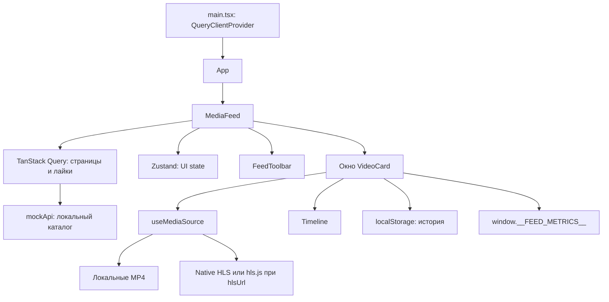

# Архитектура

[Карта документации](README.md) · [Медиа](MEDIA.md) · [Интерфейс](INTERACTIONS.md)

## Поток данных



`mockApi` — модуль внутри приложения. Вызовы `fetchFeedPage` и `updateLike` имитируют задержку через таймеры, но не отправляют HTTP-запросы к backend. HTTP используется для загрузки статики.

## Разделение ответственности

| Модуль | Ответственность |
|---|---|
| [main.tsx](../src/main.tsx) | React StrictMode, корневой QueryClient |
| [MediaFeed](../src/components/MediaFeed.tsx) | Страницы, лайки, активный индекс, ввод, окно карточек |
| [VideoCard](../src/components/VideoCard.tsx) | Жизненный цикл видео, повтор, ошибки, прогресс и действия |
| [FeedToolbar](../src/components/FeedToolbar.tsx) | Профиль сети и выбор повторов |
| [Timeline](../src/components/Timeline.tsx) | Просмотренная и буферизованная части, seek |
| [useMediaSource](../src/hooks/useMediaSource.ts) | MP4, native HLS, hls.js и очистка HLS instance |
| [useNetworkProfile](../src/hooks/useNetworkProfile.ts) | Оценка сети через доступный Network Information API |
| [usePrefersReducedMotion](../src/hooks/usePrefersReducedMotion.ts) | Подписка на системное предпочтение reduced motion |
| [feedStore](../src/store/feedStore.ts) | Общие настройки и команды playback |
| [viewedVideos](../src/lib/viewedVideos.ts) | Чтение и запись истории просмотров |
| [metrics](../src/lib/metrics.ts) | Ограниченный журнал диагностических событий |

## Состояние

**TanStack Query** хранит страницы `FeedPage`, метаданные и лайки. Видео не дублируются в Zustand. Настройки запроса: `staleTime = 5 минут`, `gcTime = 30 минут`; корневой QueryClient задаёт две повторные попытки запросов и одну для мутаций, без обновления при возврате фокуса окна.

**Zustand** хранит `activeIndex`, `muted`, `repeatMode`, `scrollDirection` и `togglePlaybackToken`. Последний передаёт команду переключения playback активной карточке. Между сеансами сохраняется только `repeatMode`; новый сеанс начинается с индекса `0` и `muted = true`.

**VideoCard** хранит локальные playback/buffering/error-состояния, длительность и прогресс. Ссылки на video, таймеры, requestAnimationFrame и счётчики лежат в refs. Обновление таймлайна ограничено примерно десятью разами в секунду и не проходит через общий store.

## Каталог и пагинация

Контракты определены в [types/feed.ts](../src/types/feed.ts):

```ts
interface FeedPage {
  items: FeedVideo[];
  nextCursor: number | null;
}
```

У `FeedVideo` есть ID, автор, заголовок, описание, URL постера и MP4, необязательный `hlsUrl`, лайк, число лайков и длительность.

В каталоге 45 записей, использующих шесть пар MP4/WebP. Страница содержит 15 записей. Первый cursor — `null`, следующие — числовые смещения; у последней страницы `nextCursor = null`. Задержка выдачи — 380 мс. Запрос получает `AbortSignal` для отмены ожидания.

Следующая страница запрашивается при `activeIndex >= videos.length - 3`, если она есть и ещё не загружается. Уже загруженные элементы остаются при ошибке дозагрузки; в UI предусмотрена кнопка повтора. Начальная ошибка показывает отдельное состояние.

## История и локальная перестановка

При создании ленты считывается история ID. Непросмотренные записи идут перед просмотренными, сохраняя порядок внутри групп. Просмотренные записи не исключаются из каталога. Снимок истории фиксируется для текущего экземпляра ленты, чтобы порядок не менялся во время пагинации. В query key входят первые 30 ID снимка, а в mock API передаётся весь снимок.

Запись считается просмотренной, когда позиция активного видео достигла двух секунд **или** 25% длительности. Это проверка `currentTime`, а не накопленного времени фактического просмотра: перемотка тоже может выполнить условие.

История содержит до 500 уникальных ID, последние добавленные идут первыми. Ошибки чтения, некорректный JSON и ошибки записи обрабатываются без остановки ленты. Позиция воспроизведения не сохраняется.

## Лайки

Поток мутации:

1. Отменить запросы ленты и сохранить снимок Query cache.
2. Оптимистично изменить `liked` и `likes` в страницах.
3. Выполнить `updateLike`, задержка — 220 мс.
4. При ошибке восстановить снимок.

Моковая мутация меняет каталог в памяти и штатно не имитирует ошибки. После перезагрузки состояние сбрасывается. Обработчик rollback присутствует, но для его проверки нужно отдельно моделировать отказ. Конкурентные мутации и серверная идемпотентность требуют доработки перед подключением backend.

## Диагностика

События имеют `timestamp` из `performance.now()`, имя и необязательные `videoId`, `value`, `details`. Последние 300 событий доступны в `window.__FEED_METRICS__`, в dev также выводятся через `console.debug`.

Текущие имена событий: `navigation_started`, `navigation_completed`, `video_activated`, `video_completed`, `video_marked_viewed`, `time_to_first_frame`, `buffering_started`, `media_fatal_error`, `timeline_seek`, `like_added`, `like_removed`.

`time_to_first_frame` измеряется до события `playing`, а не до подтверждённой отрисовки кадра. Серверной отправки, bitrate/ABR-телеметрии, измерения dropped frames и отдельного события переключения звука нет. Целевые метрики описаны в [плане развития](ROADMAP.md).
