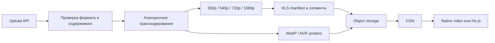

# План развития

[Карта документации](README.md) · [Текущая оценка](PROJECT_REVIEW.md)

Все пункты ниже — дальнейшая работа. Они не входят в текущие гарантии демо.

## 1. Стабилизация прототипа

- Исправить и проверить media error/reset/retry lifecycle.
- Ограничить HLS-восстановление и добавить явную политику runtime fallback.
- Проверить быстрые лайки, concurrent mutations и rollback.
- Исправить подключение ResizeObserver, отмену жестов и вложенные keyboard-controls.
- Проверить длинную инерцию трекпада и стабильность автоматической дозагрузки при ошибках.
- Добавить минимальные автоматические проверки критических сценариев из [TESTING.md](TESTING.md).

## 2. Media backend и доставка



Базовый вариант совместимости — H.264/AAC и MP4 fallback. HEVC/AV1 требуют проверки поддержки целевых клиентов и затрат на обработку. Дополнительно нужны статусы обработки, webhook/polling, правила доступа и signed CDN URLs.

## 3. Feed API

Предлагаемый контракт сервера:

```text
GET /api/feed?cursor=<opaque-cursor>&limit=15&exclude=<history-token>
```

Курсор должен быть непрозрачен клиенту. Нужны персонализация, стабильная выдача между страницами, ограничение дубликатов, token истории вместо сотен raw ID, идемпотентный endpoint лайка и приём impression/view-событий. Реальные запросы должны корректно отменяться и обрабатывать ошибки.

## 4. Координатор воспроизведения

- Пул до трёх плееров с контролем памяти и повторным использованием HLS.
- Остановка фоновой загрузки previous и уменьшение media window на слабых устройствах.
- Page Visibility API, pause при уходе приложения в background.
- Offline/reconnect UX.
- Решения по фактической скорости сегментов, ready/buffered состоянию, паузам и частоте свайпов.
- Отложенная загрузка hls.js и анализ размера клиентского JS.

Предлагаемые ориентиры предзагрузки, требующие измерений:

| Условия | Active | Next |
|---|---|---|
| Быстрая сеть | 8–12 секунд | 4–6 секунд |
| Умеренная сеть | 6–10 секунд | Manifest и первый сегмент |
| Ограниченная сеть / Save Data | Низкий rendition и безопасный буфер | Только постер |
| Нет Network Information API | Оценка по runtime-метрикам | Метаданные или короткая предзагрузка |

Эта таблица отличается от текущей реализации `preload`, которая описана в [MEDIA.md](MEDIA.md#реальная-стратегия-preload).

## 5. Метрики и качество

Нужны серверная доставка аналитики, длительность buffering, bitrate, ABR switches, ошибки HLS, загруженные байты, dropped frames и число живых плееров. Текущий журнал событий — диагностический, без полноценной observability-платформы.

| Показатель | Начальная гипотеза, не измеренный результат |
|---|---|
| Time to first frame | p75 < 800 мс на 4G |
| Rebuffer ratio | < 1% времени просмотра |
| Swipe-to-frame | p75 < 300 мс при готовом next buffer |
| Fatal playback errors | < 0,5% запусков |
| Wasted bytes | Минимизировать байты непросмотренных роликов |

Проверять на реальных iOS/Android-устройствах, с разными сетями и CPU throttling, длительным просмотром и контролем утечек. Нужны device matrix, visual regression, synthetic media failures, RUM и performance budgets.

## 6. Продукт и доступность

Субтитры, quality selector, share, comments, жалобы на контент, настройки экономии данных и Picture-in-Picture — возможные направления развития. При выходе за рамки прототипа также нужны авторизация, модерация и соответствующие продукту ограничения контента.

Режим повторов стоит проверить пользовательскими тестами и при необходимости перенести в компактное меню. Порядок фокуса, screen reader и сочетание shortcuts с нативными элементами требуют аудита.

## Архитектурные компромиссы

| Решение | Польза | Цена |
|---|---|---|
| Управляемая навигация | Дискретные переходы между роликами | Собственная обработка жестов, инерции и доступности |
| Окно девяти карточек | Сочетание viewport-sized snap и ограниченного DOM | Собственная логика spacer, resize и lifecycle |
| Подключённый previous | Быстрый возврат | Память и возможная фоновая загрузка |
| Network Information API | Недорогой начальный сигнал | Неполные данные и необходимость runtime-проверок |
| Локальный MP4 | Автономный запуск | Не показывает production-доставку и ABR |
